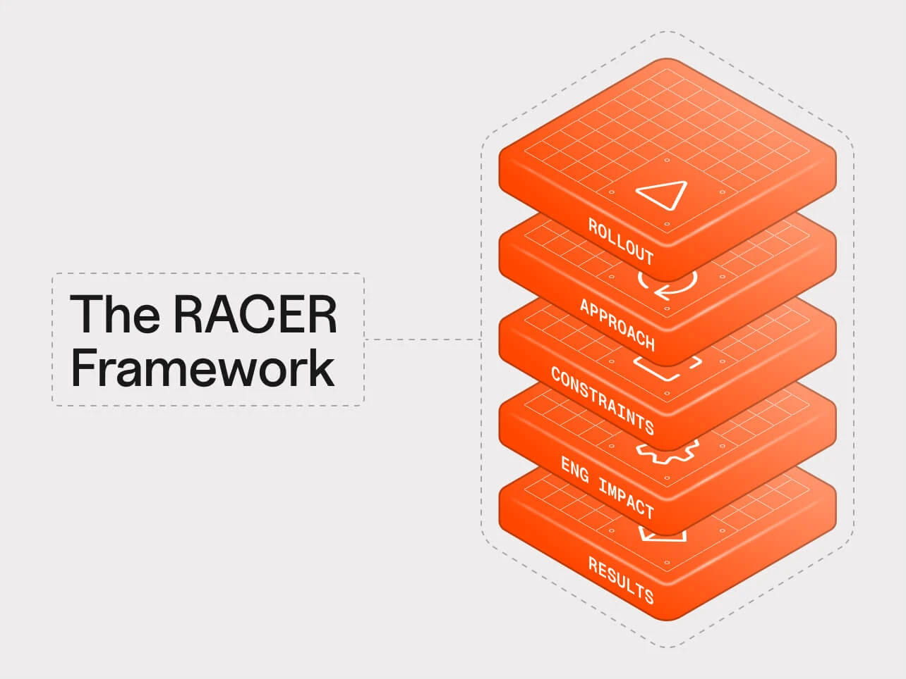
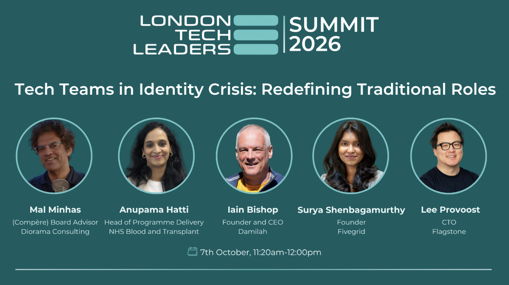
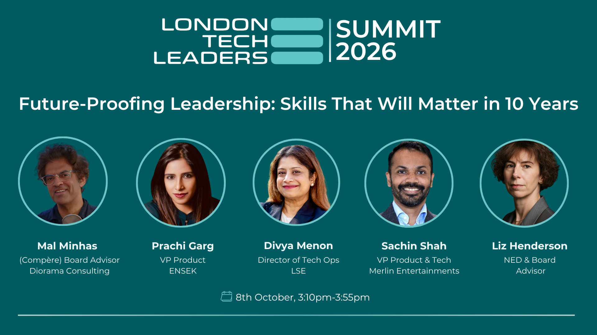

**Reflections from two days at the London Tech Leaders Summit 2026**

It has been a dislocating year to be a technology leader. Agentic coding has moved from novelty to default in a remarkably short space of time, with frontier and open-weight models leapfrogging each other in capability every few weeks. Almost every organisation I speak to is trying to work out what its tech teams should look like on the other side. So it felt timely to spend two days earlier this month on the 7th and 8th October at the [London Tech Leaders Summit 2026](https://registration.crowdcomms.com/ltls2026) in the company of dozens of CTOs, CIOs and senior technology leaders grappling with exactly those questions. It was a fantastic event, with great insights, hands-on workshops and some of the best round tables I have sat in for a long time.

I had three roles across the two days. On Day 1 I compèred the *Tech Teams in Identity Crisis: Redefining Traditional Roles* panel and led an unconference round table in the afternoon. On Day 2 I compèred the *Future-Proofing Leadership: Skills That Will Matter in 10 Years* panel in the last slot of the summit. I also participated in an AI rollout workshop on the first morning, which turned out to be one of the most useful hours of the event. This post is an attempt to pull the threads together while they are still fresh.

The exhibitor floor was itself a good barometer of where attention currently sits. The breadth was striking, ranging from [Cloudflare](https://www.cloudflare.com) and [Codurance](https://www.codurance.com) to [Plandek](https://plandek.com), [Aikido](https://www.aikido.dev), [DX](https://getdx.com/) and [Damilah](https://www.damilah.com) to [Tyme Technologies](https://tymetechnologies.io/), covering infrastructure, engineering consultancy, delivery analytics, developer security and engineering services. Almost every layer of the modern tech organisation was represented. The event agenda was dominated by AI and almost every conversation I had on the floor found its way back to AI agents sooner or later.

### **The AI transition is uneven**

The Day 1 workshop was run by the Plandek team around their *AI Transition Playbook*, which looks at rollout, adoption, constraints and engineering impact. The format was simple: small tables, a booklet, a timer and leaders comparing notes on where their organisations actually are rather than where they would like to be. What came through most clearly was how uneven the picture is. Agent-authored share of pull requests ranged from under 10% at some tables to 25–50% at others, and Plandek see customers where agents now produce around 90% of the code. The variance within a single organisation can be just as stark. One example cited an engineer producing 952 PRs in a year against a colleague's 100, with the difference entirely due to agentic tool use. The underlying technology matters too, with legacy mainframes and monoliths seeing far lower gains than greenfield code. Plandek’s RACER framework for managing AI rollout in a technical organisation was used to frame the discussion.

Two findings stuck with me. The first is that more throughput is not the same as faster delivery. One team had expected cycle times to fall after introducing AI, and instead saw capacity rise while time-to-process stayed flat. That fits the playbook's framing that AI amplifies whatever constraints you already have. If QA is your bottleneck today, AI will simply make it a bigger one. The second was the debate between *human-in-the-loop* and *human-on-the-loop*. Most of the room came from regulated industries such as banking and financial services, and most landed on human-in-the-loop as non-negotiable for now. The counterpoint, which aligns with my personal view, is that you won't realise the transformation benefits if a human has to approve every change. The organisations moving fastest, including two financial services firms that were cited, are shifting to governing and measuring outputs rather than approving each one. A staged path emerged as the practical consensus: i) AI reviews code and a human merges, ii) you build confidence in the quality of the AI review, and iii) you automate low-risk changes end to end.

The thread I pushed on was ROI, which in my view is really two different problems. Measuring AI ***in the software development lifecycle (SDLC)*** is tractable if you have baselines, albeit constrained. Measuring AI ***in the product*** is much harder, notably in consumer businesses where companies are adding AI features to keep pace with competitors rather than because the return is clear, and where you can't easily charge the end user for them. AI-first customer support that makes it near impossible to reach a human may look efficient on a dashboard while quietly eroding trust. And if an organisation has low AI maturity with no consistent usage, measuring ROI further up the stack becomes proportionally harder because there is no baseline to start from. On a more encouraging note, one firm has set up its UX engineers, who don't write HTML, to submit AI-generated PRs for pixel-level fixes that would otherwise never get prioritised. It's low risk, but it is a genuine first step towards the wider business generating code. Several people also observed that product managers forced to articulate requirements to an AI end up thinking much harder about their product than they did when they could simply hand it over to an engineer.

### **Panel: Tech Teams in Identity Crisis**

*Diagram 1: Tech Teams in Identity Crisis panel, 7th October*

My Day 1 panel brought together Anupama Hatti, Head of Programme Delivery at NHS Blood and Transplant, Iain Bishop, Founder and CEO of Damilah, Surya Shenbagamurthy, Founder of Fivegrid, and Lee Provoost, CTO of Flagstone. The brief was simple to state and hard to answer. AI is rewriting what existing tech roles are *for*. Engineers are asking what years of craft are worth if they are reviewing machine output rather than writing it, and leaders are asking how to grow the next generation when the entry-level work AI does best is exactly what juniors used to learn on.

The consensus was evolution rather than extinction. Roles are morphing rather than disappearing, and organisations are moving at very different speeds from copilot use through to full agentic orchestration. Iain argued that mindset rather than experience level predicts who thrives, since he sees experienced and inexperienced developers alike struggling and succeeding. Surya described how her team experimented with [Shape Up](https://www.productplan.com/glossary/shape-up-method), found it created a handful of champions while others fell behind, and went back to basics with Kanban. Her advice was not to wait for someone else to write the rulebook. Lee named the elephant in the room: many developers are asking why they spent a decade honing their craft only to end up babysitting a coding agent. This links to an [emerging sense of grief](https://leaddev.com/career-development/engineers-grieve-a-job-that-no-longer-exists) for many old hands in the industry and the wrenching changes going on and the passing into history of the craft we spent so many years learning. He also made the point that it feels like we've been on this journey for years because it is so intense, when for most organisations it has only been six to nine months.

The audience pushed for specifics on team shape and the panel obliged:

1. **Ratios are shifting fast.** Iain described a B2B re-platforming project that a year ago would have been staffed at five engineers to one product person. Today it is two to one, plus DevOps and a head of QA.
2. **AI-native teams are small.** Lee described teams of roughly one product builder, one or two engineers and a part-time designer, and a partner portal rebuilt in about a third of the time with half the team. He was equally clear that teams running critical infrastructure still need enough engineers to share 24/7 on-call duties without burning out.
3. **Context dictates everything.** Anupama made the case that in healthcare and life sciences, patient outcomes mean adoption has to be gradual and responsible, and no universal ratio applies. I wrote about the same tension between core and flexible capacity in [Tech Organisation Design](/insights/tech-organisation-design/) last year, and it has only become more acute.

On which roles gain, Lee's answer resonated most with me. The disciplines that have historically played second fiddle to engineering, namely SRE, cloud, platform, security and governance, are likely to command a premium over the next 12–18 months. Everyone wants to build, but very few organisations have the guardrails to deploy vibe-coded applications safely at scale. I would add GDPR and PII governance to that list given the level of acquisition activity by overseas entities where data obligations aren't always well understood. Surya described a business analyst who upskilled herself into building prototypes and product managers who became orchestrators of agentic workflows producing a first-pass codebase for engineers to review. Anupama shared that when she launched a Women in AI workstream on 1 October, 73 people volunteered within a week compared to 8–10 for a similar call a couple of years ago, from biomedical scientists and statisticians to nurses and engineers. That is what redefining roles looks like in practice.

On human skills, Iain called out courage as underrated. Leaders need to run experiments, start small and push the envelope. Surya noticed that the technical requirements in her job descriptions kept changing while the soft-skill requirements stayed exactly the same, so her interviews now index more heavily on collaboration, critical thinking and accountability. Lee closed with a warning that deserves more attention than it gets. AI tools are making people more isolated, compounding what remote working started, and nobody on the panel had an answer to it yet. I wrapped up by pointing out that, as of yet, AI doesn't do lunch. My three themes for the session were judgement over generation, accountability over authorship, and human skills over technical access.

### **Are agents digital immigrants?**

In the afternoon I led a round table with an unconference theme, where the group sets its own agenda. We ended up somewhere I didn’t entirely expect, discussing and debating humans versus agents, and it turned into one of the liveliest conversations I had during the summit.

It is important to state upfront that agents are not humans. Anil Seth has argued eloquently in [Being You](https://www.anilseth.com/being-you/) and in [a more recent post on AI specifically](https://www.noemamag.com/the-mythology-of-conscious-ai/) that consciousness is rooted in being a living, embodied creature, and that each of us is shaped over a lifetime by our own experience. An agent has none of that. It has no uniqueness. It is a digital clone, copied as many times as anyone cares to pay for. The analogy that follows is therefore not about what agents are, but about the economic and political forces they set in motion.

With that caveat, I made the point that AI agents are a form of digital immigrant, and they are entering our workforce in very large and uncounted numbers. Look at how many issues there are with human migration right now across the UK, Europe and the US. It dominates our politics, and the arguments are fundamentally about work, wages, public services and identity. Now imagine a new arrival that can be replicated in seconds, works around the clock, needs no housing and is entering the labour market at a scale and speed no country has ever experienced. If societies are struggling to absorb human migration at current levels, it isn’t hard to imagine how much worse the backlash could be once digital immigrants are visibly taking jobs.

The analogy is useful precisely because it forces questions that the "AI is just a tool" framing lets us sidestep:

1. **Who decides how many come in?** There is currently no border control for agents. Deployment decisions sit with individual firms optimising for cost, not with any democratic process.
2. **Who benefits and who bears the cost?** The productivity gains accrue to the organisations deploying agents. The displacement falls on specific workers and communities, often in exactly the entry-level roles we had been discussing on the panel that morning.
3. **What does integration look like?** We expect new arrivals to be onboarded, held accountable and governed by the same rules as everyone else. The equivalent for agents is identity, permissions, audit and accountability, which most organisations simply haven't built yet.

I'm not arguing for pulling up the drawbridge. But technology leaders are the ones letting these digital immigrants in, and if we don't take the question of social licence seriously, someone else will take it seriously on our behalf, and probably much less thoughtfully.

### **Panel: Future-Proofing Leadership**

*Diagram 2: Future-Proofing Leadership panel, 8th October*

My Day 2 panel brought together Prachi Garg, VP Product at ENSEK, Divya Menon, Director of Tech Ops at LSE, Sachin Shah, VP Product & Tech at Merlin Entertainments, and Liz Henderson, NED and Board Advisor. It was in the second-last slot of the summit, so the brief was to keep the energy up and go a little lighter on AI. I opened with a scenario. You arrive at work in 2036 and you don't open email, because overnight agents have prioritised your day, analysed customer behaviour, drafted your board papers and flagged a compliance risk before anyone else noticed. None of that is science fiction, and most of it is being piloted by people in the room right now. So the question isn't what the machines will do. It's what is left for us.

On which skills are future proof, the panel split usefully. Sachin argued that engineering and architecture foundations still matter because systems thinking is what lets you verify that what agents build is what the business actually needs. Liz made the case for emotional intelligence, constructive challenge and culture, predicting that in ten years nobody will even mention AI. Prachi talked about curiosity, systems thinking and human connection, with leadership shifting from directing tasks to creating trust, clarity and belief. Divya challenged the premise altogether, arguing that few skills are truly future proof and the foundational ones are judged under uncertainty, ethics, resilience and enabling others.

In my own comments I wanted to underline just how hard the future is to predict, and I reached for two books to make the point. The first was Donald Norman's [The Invisible Computer](https://en.wikipedia.org/wiki/The_Invisible_Computer), published in 1998, which captured the conviction of an earlier generation that computers would disappear into everyday things, right down to the literal fabric we wear, and no longer be in our face. A casual look around any room, or any Tube carriage, shows how far from the mark that proved to be. If anything, our screens have never been more in our faces. The second was E. M. Forster's [The Machine Stops](https://en.wikipedia.org/wiki/The_Machine_Stops), written in 1909, which is a salutary warning about the dangers of over-reliance on technology. In Forster's story, humanity becomes so dependent on an all-providing Machine, and so deskilled by it, that when it one day stops working people die en masse because they no longer know how to survive without the machine’s loving grace. It is a warning to the future from the past, and one that feels uncomfortably relevant as we hand ever more of our thinking and doing to agents.

On staying one step ahead, my framing was that you don't do it by predicting the future but by shrinking the time between noticing a change and learning from it. Prachi took that further: rather than asking what skills you will need in ten years, build an organisation that can change its skills, structure and ways of working every few years, with teams that blend people, agents and automation. Divya pointed out that trying to know every technology deeply is an expensive way to learn. It's better to know the direction of travel well enough to challenge assumptions, including geopolitics, Gen Alpha and Beta, and customers who may themselves be machines. Sachin argued for being vulnerable enough to say "I don't know", and Liz for the psychological safety that lets teams share half-formed ideas, adding that your digital twin may soon be taking meetings for you. We had a good-natured disagreement on whether leaders need to stay hands-on. My view is yes. Sachin's is that it depends on the size of the organisation and isn't always possible at scale.

The closing question was whether CTOs will be the next CEOs. Every company is becoming a software, data and agent-run business, so the leader who understands the engine has a real claim on the top job. Divya observed that CEO roles are moving towards technology faster than CTO roles are moving towards the CEO seat, with C-suite roles already blending. Prachi argued that every credible CEO will need technology judgement, and that the gap for a CTO is breadth, including knowing when technology should *not* lead. Sachin pointed to the rise of the CPTO as evidence that the path already exists for those with commercial acumen. Liz reminded us that every C-suite is a snowflake, and that NED and trustee roles offer another route to building that breadth, something I can personally vouch for from my own charity trustee work. My three themes to close were judgement over tools, adaptability over prediction, and breadth over depth.

### **Reflections**

Looking back across the two days, the common thread was that cheaper generation does not lower the bar for judgement, and accountability doesn't move to AI just because authorship has. If engineers are reviewing AI output rather than writing it, something has to replace the slow, hands-on apprenticeship that built senior judgement in the first place, and simply deferring everything including judgement to an AI is not a plan. EM Forster's cautionary tale, [The Machine Stops](https://en.wikipedia.org/wiki/The_Machine_Stops), is the extreme version of what happens if we get that wrong. The platform, security and governance functions that have historically sat behind engineering are about to become the ones that determine how fast everyone else can safely move. Delivery leaders should be watching cycle time rather than just throughput, because if capacity is up and lead time is flat, AI has found your bottleneck for you. And product and commercial leaders need to separate the ROI of AI in the SDLC from the ROI of AI in the product, because the second is far harder to prove.

Underneath all of that sits the digital immigrant question. How many agents we let in, how we govern them and how we treat the people they displace is going to become a political issue, not just an operational one. I suspect it is one of the least discussed aspects of the current transition, and I hope to explore it further in a future post.

### **Next Steps**

Huge thanks to the London Tech Leaders team for a superbly run event, to my eight panellists for their candour, to everyone who joined the unconference table and to the exhibitors who made the floor such a good place for real conversations. If you are wrestling with how to reshape your tech organisation for an agentic world, or want to continue the human vs agent debate, get in touch. I'd be interested to hear how your experience compares.
